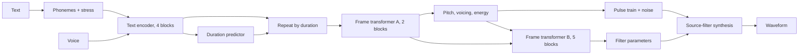

# Model and data (tiny-voca-ptbr)

## Model

The text encoder and the two frame-level transformers use pre-norm blocks with
rotary position embeddings (192 channels, 4 heads). Durations, pitch, voicing
and energy are predicted explicitly, as in FastSpeech 2.

The waveform is produced by a source-filter synthesizer instead of a neural
vocoder. A band-limited pulse train at the predicted pitch and a noise signal
are each shaped by a time-varying filter, whose cepstrum the network predicts
once per frame (hop 256 samples, 10.7 ms). This part has 25,862 parameters.

| Component | Parameters |
|---|---:|
| Embeddings (55 symbols, stress, voice, position) | 12,672 |
| Text encoder | 1,588,864 |
| Duration and pause predictor | 123,906 |
| Frame transformer A, prosody head | 795,971 |
| Frame transformer B | 1,985,984 |
| Source-filter waveform head | 25,862 |
| Total at inference | 4,533,259 |

Two modules exist only during training: an auxiliary mel head (15,440
parameters) and the waveform discriminators (2,675,312).

## Data

The training audio is synthetic and Brazilian Portuguese. Both voices (`F_s4`,
`M_sm4`) were designed from text descriptions with Qwen3-TTS VoiceDesign, and
every clip was generated with Chatterbox Multilingual pt-BR (MIT) using those two
reference clips. No recording of a real speaker is involved. Each clip was
screened with Whisper large-v3-turbo and rejected above 15% word error rate.

The data are published as
[`semfence/ptbr-synthetic-speech`](https://huggingface.co/datasets/semfence/ptbr-synthetic-speech)
(20,442 clips, 24.7 hours, CC BY 4.0). The texts are in
[`semfence/ptbr-sentences`](https://huggingface.co/datasets/semfence/ptbr-sentences):
Mozilla Common Voice Portuguese sentences (CC0), sentences written with Qwen3-8B,
and templates for numbers, dates, money and times. Validation and test texts are
kept out of training.

Phoneme durations come from forced alignment with
`facebook/wav2vec2-lv-60-espeak-cv-ft`, used only to label the training data. It
has no label for the nasal glides `j̃` and `w̃`, so they are aligned as `j` and
`w` (`ALIGNER_LABEL_FALLBACK` in `align.py`).

## Training

Training has two phases: spectral losses only for the first 8,000 steps, then
an added adversarial loss with multi-period and multi-resolution
discriminators. The released checkpoint is step 104,000, trained on one rented
RTX 5080 in about 8 hours (about US$3 of GPU time). The validation losses stopped
improving much after about 30,000 steps; the rest of the run did not change
them noticeably.

## Evaluation

Word error rate of synthesized speech from text alone (predicted durations,
pitch and energy), transcribed with Whisper large-v3-turbo (`language=pt`).

| Sentences | Clips | WER |
|---|---:|---:|
| Test texts, never seen in training | 96 | 0.55% |
| New sentences, in no split | 32 | 0.0% |

These sets are small, the scorer is an automatic model, and there was no
listening test with people. A low WER says the words are intelligible, not that
the voice is natural. The sound quality is that of the original tiny-voca (a
source-filter synthesizer, not a neural vocoder). Details are in
[`release/README.md`](../release/README.md).

## Third-party components

[dizione-ptbr](https://github.com/SemFence/dizione-ptbr) (Apache-2.0; its
dictionary is the MFA Brazilian Portuguese dictionary, CC BY 4.0), Chatterbox
Multilingual pt-BR (MIT, generated the training audio), Qwen3-TTS (Apache-2.0,
designed the two reference voices), Qwen3-8B (Apache-2.0, wrote part of the
sentences), `facebook/wav2vec2-lv-60-espeak-cv-ft` (Apache-2.0, alignment only),
Whisper (MIT, screening and evaluation only) and Mozilla Common Voice sentences
(CC0). eSpeak NG is not used anywhere.

The design is that of [tiny-voca](https://github.com/n4ze3m/tiny-voca) (Muhammed
Nazeem, Apache-2.0), which builds on FastSpeech 2, DDSP and the neural
homomorphic vocoder, and HiFi-GAN and UnivNet. No code or weights from those
projects are used.
